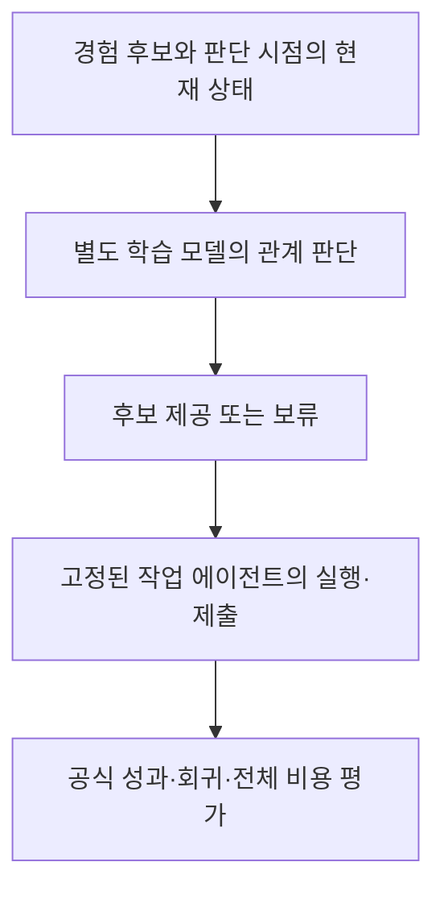

# 큰 방향 재검토: 별도 학습 모델이 맡을 일

2026-11-07. 사용자가 메모리 연구의 큰 방향과 별도 학습 모델의 필요성을 다시 물어 작성한 **제안**이다. 새 학습·과제 실행·GPU 할당·API 지출은 없다. 기존 완료 보고서·동결 계획을 바꾸지 않는다.

**추천 방향은 과거 경험의 현재 적용성을 판단하는 별도 모델을 만들고, 그 모델이 실제 기억 제공 정책을 개선하는지 검증하는 것이다.** 현재의 복원 실험과 근거 판독 학습은 이 연구를 위한 진단 자료로 둔다. 모델을 추가했다는 사실이나 LoRA 자체를 기여로 삼지는 않는다.

여기서 별도 모델은 외부 경험을 읽고 활용을 판단하는 모듈을 뜻한다. 경험을 전부 가중치에 내장하는 모델이나 작업 에이전트 자체의 추가 학습과는 구분한 설계다. 역할·시점·학습 신호를 정한 다음 모델 구조를 고른다.

## 한 문장으로 잡을 연구 질문

> 작은 별도 모델이 현재 상태와 과거 개발 경험의 적용 조건을 비교해, 새로운 문제에서 기억을 제공하거나 보류하는 판단을 학습하고, 그 판단 비용을 포함해 코드 에이전트의 성과를 개선할 수 있는가?

‘어떤 기억이 좋은가’는 현재 문제·환경·작업 모델·예산에 조건부인 질문이다. 과거 사실이 맞아도 현재에는 중복이거나 직접 적용할 수 없을 수 있다. 직접 수정법은 맞지 않아도 원리나 실패 기록은 유용할 수 있다. 적용성 점수 하나를 곧바로 유익/유해의 정답으로 사용하지 않는다.

## 별도 모델을 어디에 둘 수 있나

| 역할 | 판단/출력 | 첫 연구로서의 판단 |
| --- | --- | --- |
| 관련 기억 검색·재순위화 | 문제와 관련 있는 후보의 순위 | 필요한 강한 기준선. 유사성 자체와 실제 유용성을 구별해야 함 |
| 현재 적용성·용도 판단 | 현재 조건과 과거 전제의 일치, 중복, 직접 적용/원리 전이의 경계 | **첫 학습 모델의 중심으로 추천** |
| 결과 기반 제공 정책 | 제공·보류의 예상 성과/비용 또는 행동 선택 | 최종 검증 대상. 현재 실제 효과 자료가 부족함 |
| 기억 작성·갱신 | 무엇을 보존·삭제·다시 쓸지 결정 | 중요한 후속. 쓰기·선택·작업 수행을 함께 바꾸면 기여 귀속이 어려움 |

현재 Harrier 숫자 판독은 학습·저장 경로의 기능 점검이다. 숫자를 읽는 분류기를 계속 개선하는 것만으로 이 연구 질문에 도달하지는 않는다. 기억의 근거 판독은 보조 과제로 남기고, 학습의 주 입력에 현재 상태와 과거 전제의 관계를 넣어야 한다. Harrier·선형층·MLP·LoRA는 이를 시험하는 후보이며 지금 특정 구조가 필요하다는 근거는 없다.

## 권하는 첫 시스템

처음에는 후보 내용과 결정 시점을 고정하고 제공/보류만 비교한다. 이후 같은 경험을 직접 행동 지침으로 사용할지, 관찰·가설의 근거로만 사용할지 판단하는 축으로 확장할 수 있다. 시작부터 자유로운 재작성·검색·검증·삭제를 모두 학습시키지는 않는다. 그 경우 모델이 새 정보를 만들었는지, 더 많은 추론을 했는지, 기억 선택을 개선했는지 분리하기 어렵다.

판단 시점도 하나로 정한다. 시작 시 선택에는 사전에 공통 수집한 관측만 사용할 수 있다. 예정 명령을 읽는 실행 중 조회 모델은 그 명령을 알게 된 시점의 별도 정책이다. 현재 초기화 후보는 후자에 해당하며, 이를 시작 시 선택 데이터로 그대로 옮기면 처치 뒤 정보가 섞인다.

## 데이터는 이렇게 연결한다

| 층 | 학습/관측 자료 | 주장할 수 있는 것 |
| --- | --- | --- |
| 출처 근거 | 기억 문장·실제 원문·검사 범위 | 과거에 관측된 사실·시도인지 |
| 현재 관계 | 같은 기억·다른 현재 조건·판단 전 코드/환경 | 직접 적용·중복·원리 전이·미확인의 구분 |
| 실제 가치 | 새 과제에서 같은 후보의 제공/보류 결과 | 해당 정책의 성과·비용 효과 |

첫 두 층의 주석은 전체 에이전트 실행보다 저렴하게 만들 수 있는 후보지만, 실제 이득의 대체 라벨은 아니다. 실제 수치·명령·표시된 검사는 구조화 규칙으로 추출하고, 그 사실의 범위와 현재 조건의 관계를 별도로 주석한다. 같은 기억을 현재 조건만 달라지는 대조에 놓아야 한다.

학습 목표를 바로 `이득/손해`로 고정하면 현재4쌍·2출처의 작은 결과 차이를 정답으로 오인하기 쉽다. 먼저 실제 관계 판단을 평가하고, 효과 자료가 충분해지면 제공·보류의 조건부 결과를 학습하거나 독립된 정책 학습으로 확장한다. 보조 판독 점수가 높아진 것과 좋은 선택 정책을 얻은 것은 별도 결과다.

현재 [독립 리뷰](../training/memory_selector/reviews/2026-11-07-independent/README.md)의 후보9개는3출처의 발견 자료다. source 근거가 있는 사례만 골랐고, 관계 ontology·직접 처방 적용 양성·독립 분할이 미완성이다. 학습용 큰 데이터셋이나 새 평가 집합으로 부르지 않는다. 같은 출처·대상·파생 자료를 연결해 분할하고, 이후 확인은 새로운 경험 가족에서 수행한다.

## 별도 모델이 필요한지 증명하는 순서

1. **선택할 여지가 있는지 확인한다.** 여러 현재 조건에서 고정한 제공/보류 정책의 성과·비용 차이가 달라지는지 본다. 과제 난이도만 결과를 결정하는 패널로는 가치 학습을 평가하기 어렵다. 관측 보상이 가장 높았던 행동을 사후 골라 실현 가능한 oracle 성과로 보고하지 않는다.
2. **단순 판단을 넘어서는지 본다.** 항상 제공·항상 보류, 유사도/재순위화, 명시적인 전제 확인 규칙과 비교한다. 같은 후보·내용·전달 예산·결정 시점·작업 에이전트를 맞춘다. 필요하면 같은 작업 모델이 직접 선택하는 기준선도 두어 외부 모델 추가의 필요성을 묻는다.
3. **새 출처에서 관계 판단을 확인한다.** 기억만·상태만·전체 관계 입력을 비교한다. 같은 기억의 상태 대조와 보류/미확인 처리를 보고, 길이·숫자·runner 편법을 함께 점검한다.
4. **정책으로서 가치를 확인한다.** 고정한 학습 정책을 독립 과제에 적용하고 공식 성공·새 회귀·전체 배정 비용·지연을 비교한다. 선택기와 조회·확인 비용도 포함한다. 성과가 같고 비용만 줄면 비용 이득으로 한정한다.
5. **어떤 조각이 판단을 바꿨는지 분석한다.** 출처 조건·검사 범위·수정 처방을 정확히 삭제/복원하고 정책과 실제 성과를 따로 본다. 기존 메모리 득실 질문은 이 기전 분석으로 유지된다.

‘모델이 성공 확률을 맞힌다’보다 ‘그 모델의 선택이 기준 정책보다 좋아진다’가 핵심이다. 쉬운 과제를 알아보는 것만으로도 결과 예측 점수는 좋아질 수 있다. 모든 조건에서 기억 효과가 구별되지 않으면 그 패널에서 제공 정책을 학습할 근거도 부족하다. 분류 모델의 규모를 키우기 전에 과제·경험 관계와 행동 공간을 다시 점검해야 한다.

현재 과정 복원 파일럿은 세 과제 전조건 성공, 한 과제 완결 실행 전부 실패였고 한 배정은 중단됐다. 여기서 효과가 없다는 일반 결론도, 학습 선택기가 개선할 기회가 충분하다는 결론도 얻지 못했다. [파일럿 보고서](reports/2026-11-07-process-restoration.md).

## 선행연구를 다시 확인한 의미

- **[Retain or Consolidate? v2](https://arxiv.org/html/2607.17545v2)**는 생성 전 관측 특징으로 행동별 효용을 추정하는 작은 학습기를 제안한다. 선형 회귀가 기본이고 같은 그룹 분할의 작은 MLP가 일관된 추가 이득을 내지 않았다. 별도 학습기 자체가 새 기여는 아니며, 복잡한 구조를 전제로 시작할 필요도 없다는 참고다. 해당 실험은 대화 기억의 유지/압축 선택이고 우리의 코드 경험 적용성 검증은 별도다.
- **[MGPO v1](https://arxiv.org/html/2609.37930v1)**는 독립적인 기억 작성 정책을 고정 reader의 반사실 효용 차이로 학습한다. 문서 정보 추출·장기 QA의 결과이며 코드 에이전트 성과를 보장하지 않는다. 쓰기를 학습하려면 최근 업데이트의 추가 기여를 과거 기억의 성과와 분리해야 한다는 근거다.
- **[Memory-R2 v1](https://arxiv.org/html/2605.21768v1)**는 서로 다른 기억 상태의 rollout을 그대로 비교하는 신용 할당 문제를 다루며 같은 중간 상태에서의 국소 재실행을 사용한다. 장기 쓰기·갱신까지 학습할수록 상태 통제가 중요해진다는 참고다.
- **[What Is This Memory Useful For? v1](https://arxiv.org/html/2611.03930v1)**는 기억 효용의 과제 의존성과 측정의 변동을 다룬다. 제한된 SWE-bench 실험에서도 효과를 검출하지 못했으며 해석 가능한40셀·두 저장소 등 범위를 명시한다. 그 프로토콜을 전체 코드 에이전트에 일반화하지 않는다. 유명 벤치를 사용한다는 사실만으로 유익한 기억이나 학습 신호가 생기지는 않는다는 주의점이다.

위는 원문에서 확인한 내용이다. **우리의 차별화 후보**는 ‘코드 에이전트의 현재 상태와 과거 경험의 조건을 비교하고, 직접 처방/원리 전이의 경계를 학습하며, 그 판단의 실제 순가치를 분리해 검증’하는 것이다. 아직 독창성이나 성능이 입증된 기여는 아니다.

## 진행 방향에 대한 판단

큰 방향은 유지하되 중심을 **기억의 현재 적용성을 배우는 별도 모델과 그 정책 가치**로 좁히는 것을 권한다. 숫자 판독·복원 조각 비교·표현 비교는 데이터 품질과 기전 분석에 사용한다. 현재 Harrier 실행은 기능 점검으로 보존하고, 다음 자원은 동일 기억의 조건 대조와 새 출처에서의 실제 효과 신호에 우선 배분한다.

SWE/Terminal 같은 실제 작업 평가는 최종 타당성 확인으로 중요하다. 다만 첫 학습 신호를 전체 해결률 하나에만 의존하지 않고, 근거·전제·범위의 관계를 정의한 자료와 연결한다. 별도 모델의 필요성은 강한 간단한 정책과의 비교로 판단한다. 규칙이 충분하면 그 사실도 연구 결과로 받아들인다.
