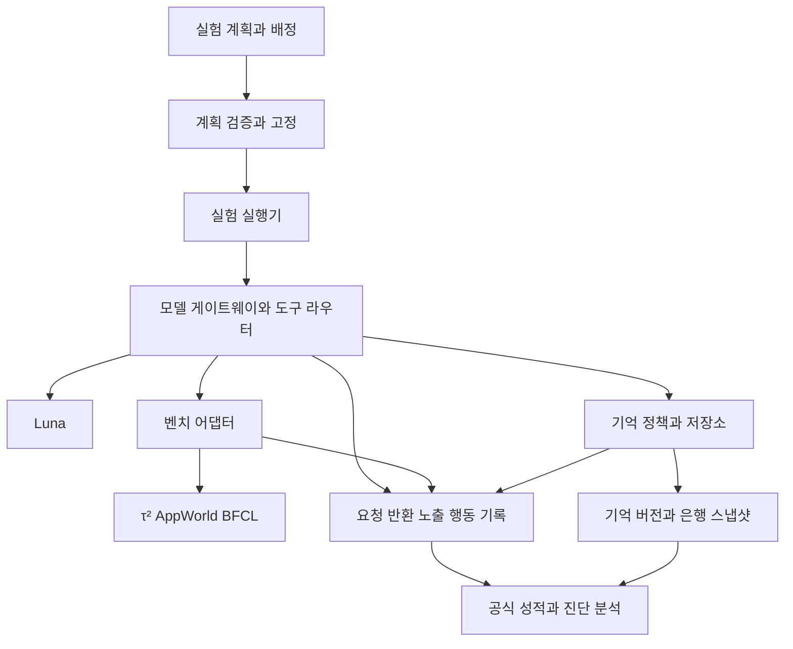
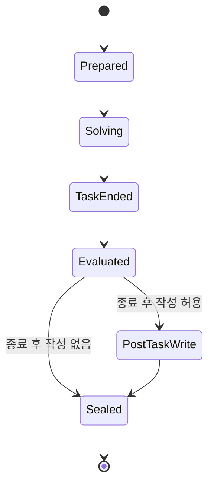

# LLM 에이전트 메모리 평가 프레임워크 상세 설계

2026-11-13 · 구현을 위한 설계안 v1

**동일한 작업자가 경험을 저장하고 선택·조회하는 방식을 바꾸며, 기억 내용과 실제 입력 노출을 후속 행동·성공·실패·진척·비용에 연결한다.** 초기 실증 환경은 τ²-bench로 두고 AppWorld와 BFCL을 별도 어댑터로 연결하는 구조를 제안한다. 작업자 Luna의 가중치는 갱신하지 않는다.

이 문서는 [실험 설계 검토안](ai-memory-evaluation-framework-design-2026-11-13.md)을 모듈·인터페이스·상태 전이·데이터 계약으로 구체화한다. 프레임워크 실행기는 앞으로 구현할 대상이다. 동봉한 [계약과 예시](design-data/agent-memory-framework-20261113-v1/README.md)는 설계 검증용이며 벤치 실행 결과가 아니다.

## 1 설계의 범위와 결정

| 항목 | 설계 결정 |
| --- | --- |
| 연구 범위 | 저장 시점·형태, 조회·선택·가공, 같은 과제 재시도, 새 과제 전이, 누적 변화와 득실·비용 |
| 초기 실험 | 1회차 경험 수집과 기억 작성 이후 2회차의 독립 세션에서 재사용·선택 평가 |
| 실행 모델 | 동일 정책 비교 안에서 Luna의 모델 ID·제공 경로·추론·도구 설정 고정 |
| 공통 계층 | 실험 배정, 기억 도구와 은행, 실제 노출 기록, 비용, 분석 |
| 환경 계층 | 과제 로딩·초기화, 사용자 시뮬레이션, 업무 행동, 종료와 공식 채점 |
| 첫 구현의 저장 방식 | Python 실행기, SQLite의 버전·이벤트 저장, JSON/JSONL 내보내기와 내용 해시 파일 |
| 조회 기본 방식 | LLM이 목록을 확인하고 본문을 선택하는 `memory_list`·`memory_get`. 검색기는 선택 가능한 정책 구성요소 |
| 한도 | 저장 용량·읽는 양·호출·시간·금액을 구분. 2k 배분이나 BM25를 공통 기본값으로 넣지 않음 |
| 구현과 검증 | 계약·오프라인 재계산·가짜 환경 검증, 실제 벤치 연결, 실증 실행을 구분 |

저장 형태와 조회 정책을 교차할 수 있게 한다. 구현 순서는 기능 의존성에 따른 것이며 연구 질문을 한 도메인·시점·손해 사례로 축소하지 않는다. 다중 환경 지원 목표와 실제 검증한 환경의 범위는 결과표에서 구분한다.

## 2 전체 구성



| 모듈 | 책임과 경계 |
| --- | --- |
| `PlanCompiler` | 설정·과제 목록·출처 분할·조건·배정표·분석 계획을 해석하고 실행 준비 상태를 판정 |
| `ExperimentRunner` | 수집·평가·누적·진단 절차, 실행 ID, 은행 소유권과 세션 생명주기 관리 |
| `BenchmarkAdapter` | 환경별 원래 실행 의미와 공식 채점 유지. 기억 내용을 정답에 맞춰 자동 선별하지 않음 |
| `WorkerAdapter` | 벤치의 에이전트 문맥을 모델 요청으로 구성. 실제 전송 직전 요청을 관측 가능하게 제공 |
| `ModelGateway` | 모델 호출, 요청·응답 원본, 사용량·오류·제공자 기록. 별칭과 반환 모델을 구분 |
| `ToolRouter` | 기억 연산과 업무 연산을 분리해 정책 허용 여부·호출 순서·종료 상태 검사 |
| `MemoryService` | 저장·갱신·목록·본문·선택적 삭제/검색과 은행 복제. 버전 및 재시도 일관성 보장 |
| `ExposureRecorder` | 저장소 반환과 실제 다음 모델 입력을 연결. 제목·본문·가공본·재노출 기록 |
| `OutcomeAnalyzer` | 공식 결과, 진척·기억 주석·개입·비용을 별도로 집계하고 불확실성 계산 |

기존 `experiments/swe_memory/`와 학습·평가 코드의 입력 계약은 유지한다. 기존의 기록·해시·비용 처리에서 재사용할 부분을 검토하되, 고정 카드 검색 정책을 새 프레임워크의 자율 기억 정책으로 전용하지 않는다.

## 3 식별자와 데이터 연결

[기록 규약](experiment-recording.md)의 `run_id`는 과제·모델·조건·반복에 따른 한 시도 단위로 유지한다. 여러 과제를 묶는 데는 새로운 `experiment_id`를 사용한다.

| 식별자 | 의미 |
| --- | --- |
| `experiment_id` | 계획과 코드·벤치·과제·모델 설정이 고정된 실험 묶음 |
| `condition_id` | 저장·조회·피드백·한도를 조합한 조건 |
| `schedule_id`, `replicate_id` | 정책 간 공유하는 과제 순서와 독립 은행 반복 |
| `stream_id` | 한 조건에서 은행을 이어받는 작업 흐름 |
| `run_id`, `session_id` | 한 과제 시도와 그 안의 모델 대화 세션 |
| `pair_id` | 사전 배정한 기준선·정책 실행의 관측 결과 짝 |
| `task_key`, `source_group_id` | 벤치·버전·과제·초기 상태의 식별과 원천/파생 과제 그룹 |
| `bank_id`, `snapshot_id` | 쓰기 가능한 은행 분기와 불변 스냅샷 |
| `item_id`, `version_id` | 모델이 선택하는 기억 항목과 불변 본문 버전 |
| `event_id`, `request_id`, `operation_id` | 사건, 모델 요청, 멱등 처리할 저장소 연산 |

`item_id`·`version_id`는 과제 ID·정답·효용을 인코딩하지 않는 불투명 ID다. 출처 과제·필요 근거·효용 주석은 분석용 자료이며 기본 도구 반환에 포함하지 않는다. LLM이 직접 작성한 제목·본문은 그대로 보존한다.

버전 ID는 전역적으로 고유하다. 같은 항목이 두 은행 분기에서 각각 갱신돼도 서로 다른 버전을 가지므로, 항목별 단순 숫자만으로 전역 버전을 식별하지 않는다. `head_revision`은 은행의 변경 횟수이며 항목 버전과 다른 값이다.

## 4 초기 실험과 확장 절차

### 4.1 경험 수집과 독립 평가


1. 실행 전에 출처 그룹·수집 과제·재시도 과제·관련 새 과제·조건 변경 과제를 구분한다. 같은 과제 재시도는 허용하되 새 과제로의 일반화 점수에 합치지 않는다.
2. 조건·순서·독립 반복별 은행을 만들고, 정책 간 같은 과제 순서를 배정한다. 초기 선택 실험은 원천 과제별 은행을 독립 작성하며 누적 수집은 별도 절차로 둔다. 각 과제의 업무 상태·에이전트 대화·사용자 시뮬레이터를 새로 초기화한다.
3. 1회차에서 LLM이 허용된 기억 도구를 사용한다. 수행 중 작성은 현재까지 공개된 경험만 참조하고 종료 후 작성은 정해진 공개 경험·피드백만 참조한다.
4. 수집 완료 은행을 불변 스냅샷으로 고정한다. 실제 항목 수 N, 제목·본문 크기, 버전과 경험 출처를 보존한다.
5. 2회차의 각 과제·반복은 같은 시작 스냅샷에서 별도 은행을 복제한다. 대화·업무·사용자 상태를 초기화하고 외부 기억을 통해 과거 정보에 접근한다.
6. 평가 중 저장이 허용된 정책은 복제본을 갱신한다. 그 변경은 원은행·다른 평가 과제·이후 본실험으로 돌려보내지 않는다.
7. 무기억도 같은 과제 배정·재시도 횟수로 수행한다. 배정 전체의 결과와 실패·결측을 보존한다.

초기 과제·업무 상태와 배정은 맞추되, 같은 사용자 seed가 에이전트 행동이 달라진 이후에도 동일한 대화를 보장한다고 가정하지 않는다. 실제 사용자 관측과 분기를 원본에 남긴다.

평가 때 공개되는 정책 문서·도구 설명 등 환경의 기본 지식은 동일하게 제공한다. 세션 분리는 과거 에피소드 이력의 분리이며 현재 과제에 필요한 정상적인 입력을 없애는 뜻이 아니다. 이전 provider 대화 ID·응답 연결 ID·에이전트 내부 상태도 새 세션에 재사용하지 않는다.

### 4.2 자기 경험과 혼합 은행

| 은행 구성 | 평가 질문 | 구성 규칙 |
| --- | --- | --- |
| `own_experience` | 해당 과제의 경험 기억을 후속 시도에서 적절히 재사용하는가 | 분석용 원천 관계로 접근 범위를 정하되 모델에게 정답 항목을 표시하지 않음 |
| `mixed_experience` | 여러 과제에서 작성한 N개 항목 중 현재 조건에 맞는 정보를 선택하는가 | 출처 포함 규칙·배정·목록 순서를 실행 전에 고정. 다른 과제의 기억도 유용할 수 있음 |

관련 기억이 없는 과제에서는 조회하지 않거나 활용을 보류하는 선택도 평가한다. N은 살아 있는 항목 수이며 버전 수·저장 정보량과 다르다. 자연적으로 생성된 N·본문량·목록량의 차이를 포함한 정책 효과와, 크기를 통제한 별도 진단을 구분한다.

순수한 후보 풀 효과를 비교할 때는 원천 과제별로 독립 작성한 동일 기억들을 사용한다. 자기 경험 은행과 그 은행들을 합친 혼합 은행을 만들고, 합치는 과정에서 LLM 재작성·자동 병합을 하지 않는다. 여러 과제를 거치며 이미 갱신된 기억에서 출처 표시만 필터링해 자기 경험을 분리했다고 가정하지 않는다. 과제 간 기억을 공유하며 수집하는 방식은 `continual`에서 별도로 비교한다.

### 4.3 추가로 지원할 실험 절차

| 절차 | 고정·변경하는 것 | 해석 |
| --- | --- | --- |
| `continual` | 과제마다 업무·대화는 초기화하고 은행은 순서대로 갱신 | 행동·경험 수집까지 포함한 누적 정책 효과 |
| `common_experience` | 같은 공개 궤적에서 여러 작성 정책으로 은행 생성 | 주어진 경험에서의 표현·작성 효과. 수행 중 작성에는 궤적 접두부만 제공 |
| `write_read_cross` | 공통 경험의 은행 A·B를 조회 정책 X·Y와 교차 | 저장·조회 조합 효과 |
| `checkpoint_probe` | 누적 중 사전 지정 시점의 은행을 복제해 같은 확인 과제 평가 | 개선 속도와 이전 과제 유지·회귀 |
| `intervention` | 최초 기억 정보 노출 전의 동일 상태에서 제공·보류·내용 교정 | 해당 상태의 개입 효과. 연구자 교정 조건은 자율 정책 성적과 구분 |

고정 은행을 읽기만 하는 진단은 별도 설정이다. 기본 평가에서 모든 정책의 쓰기를 일괄 중지하지 않는다. 은행 교환은 저장 형식·후보 정보·권한을 비교 가능하게 맞춘 경우에 수행하고, 형식 변환이 필요하면 변환 정책·내용·비용을 추가 실험 요인으로 기록한다.

## 5 정책 계약

| 정책 필드 | 값과 의미 |
| --- | --- |
| `memory_enabled` | 기억 도구와 은행을 제공하는지. 쓰기 중지와 기억 없음은 다른 조건 |
| `write_timing` | `none`, `post_task`, `during_task`, `during_and_post` |
| `representation` | 자유 작성·사건·요약·사실과 조건·절차·실패 경험 등의 지침 ID와 내용 해시 |
| `read_mode` | `none`, `on_demand`, `preload`, `preload_and_on_demand` |
| `read_transform` | `verbatim` 또는 명시한 재가공 정책 |
| `preload_selector_ref`, `curation_instruction_ref` | 자동 제공의 선택 규칙과 조회 후 가공 지침. 사용 조건에서만 필요 |
| `feedback` | `observations_only` 또는 정의한 종료 피드백 정책 |
| `same_episode_read` | 수행 중 작성한 항목을 같은 시도에서 읽을 수 있는지 |
| `catalog` | 정렬·페이지 크기·노출 필드. 목록에서 본문을 기본 제공하지 않음 |
| `limits` | 저장·조회 한도와 모델·시간·금액 중단 조건. 한도 없음은 `null` |

`memory_enabled=false` 조건에는 기억 도구·은행 내용·과거 대화가 제공되지 않는다. 현재 과제의 정상적인 업무 도구와 기본 지시는 유지한다. 쓰기가 없는 고정 은행 조회 진단은 `memory_enabled=true`와 `write_timing=none`으로 표현한다. 원기록 접근·단순 요약은 같은 경험에서 구성하는 기준선이며, 각각의 정보 접근·조회 경로를 명시한다.

정책은 LLM에게 기회를 주는 규칙이다. 지정한 저장 형식의 실제 준수 여부와 실제 저장·조회량은 관측값이다. 강제 조회 연결 점검은 별도 `guided_check`로 표시하고 자율 조회율에 합치지 않는다.

작업자 정책 안내에는 현재 단계, 허용 도구, 작성 지침과 적용하는 저장·조회 한도를 명시한다. 한도를 제공하는 조건에서는 자기 은행의 남은 용량을 도구의 운영 메타데이터로 반환할 수 있으며, 노출한 값과 형식도 기록한다. 필요성·정답·효용 주석은 이 메타데이터에 포함하지 않는다.

`preload`는 실행 전에 고정한 선택 규칙으로 제공하며 실제 후보·선택·노출과 추가 연산을 기록한다. `on_demand`의 에이전트 선택과 구분한다. 재가공을 켜면 별도 지침과 모델 호출을 기록한다. 검색·자동 선별·재가공이 비어 있는 설정에 임의 알고리즘을 보충하지 않는다.

`same_episode_read=false`에서는 도구의 읽기 보기를 해당 run 시작 snapshot으로 고정한다. 현재 run에서 새로 쓴 항목·버전은 다음 run의 읽기에 반영한다. LLM이 직접 쓴 문장은 현재 대화 이력에도 남으므로 이 설정을 모델이 자기 작성 내용을 잊는 조건으로 해석하지 않는다.

## 6 기억 도구와 은행

### 6.1 모델에게 제공하는 도구

```text
memory_store(title, body, id=null, expected_version=null)
memory_list(cursor=null, limit=null)
memory_get(id)
```

| 도구 | 처리와 반환 |
| --- | --- |
| `memory_store` 새 항목 | 새 `item_id`·`version_id` 생성. 제목·본문과 공개 경험의 마지막 사건 위치를 함께 보존 |
| `memory_store` 갱신 | `id`와 현재 `expected_version`을 요구. 일치하면 이전 버전을 보존하고 새 버전 생성 |
| `memory_list` | 정책의 읽기 보기에서 접근 가능한 ID·제목·버전, 다음 커서와 보기 revision 반환 |
| `memory_get` | 읽기 보기가 가리키는 항목의 제목·본문·버전 반환. 이전 목록과 다르면 실제 반환 버전을 기록 |

서버가 분석용 메타데이터를 자동 부착한다. 모델에게 출처 사건 ID나 미래 결과를 작성하게 하지 않는다. 기본 본문은 자유 텍스트이며, 특정 구조의 강제 검증은 해당 실험 조건에서만 활성화한다. 항목 삭제·검색이 필요하면 별도 capability를 가진 확장 도구로 제공한다. 삭제는 tombstone과 이전 버전을 남긴다.

목록 기본 순서는 생성 순서와 ID의 안정적인 순서로 고정하고 설정에 기록한다. 페이지 크기는 실행 전에 명시한다. `limit=null`이면 설정한 크기를 사용하고, 명시한 양수 limit은 그 크기 이하여야 한다. 첫 구현에서는 읽기 보기의 revision이 바뀐 커서로 다음 페이지를 요청하면 `STALE_CURSOR`를 반환해 다시 목록을 받게 한다. 같은 시도 안의 최신 은행과 불변 평가 시작 스냅샷을 구분한다.

제목·본문·목록을 몰래 자르거나 자동으로 요약하지 않는다. 문맥에 들어가지 않으면 명시한 분할·접근 정책을 적용하거나 `CONTEXT_OVERFLOW`로 기록한다. `store`의 제목·본문이 비어 있으면 `INVALID_ARGUMENT`이며 삭제로 해석하지 않는다.

### 6.2 내부 저장소 계약

```text
create_bank(owner, parent_snapshot=null) -> BankRef
execute_memory_op(bank, operation_id, request, public_context) -> ToolResult
freeze(bank) -> ImmutableSnapshot
fork(snapshot, owner) -> BankRef
compose(snapshots, pool_rule) -> ImmutableSnapshot
seal(bank) -> ClosedBankRef
```

| 데이터 | 주요 필드 |
| --- | --- |
| 은행 | 소유 조건·스트림, 부모 스냅샷, head revision과 접근 상태 |
| 항목 버전 | ID, 부모 버전, 제목·본문의 해시·파일 참조, 생성 run·사건, 공개 경험 참조 |
| 은행 head | 은행·항목이 현재 가리키는 버전. 복제 은행은 같은 불변 버전을 참조할 수 있음 |
| 스냅샷 | 고정된 head 집합, 생성 시점, 원천 은행 revision, manifest 해시 |
| 연산 | operation ID, 요청 해시, 적용 결과, 연결 사건 |

한 은행에는 한 실행 주체만 쓰기 권한을 가진다. 저장·갱신·head 변경·연산 결과·사건을 SQLite 한 트랜잭션에서 확정한다. 본문 파일은 먼저 해시로 저장한 뒤 참조하며, 실패한 트랜잭션의 고아 파일은 별도 정리 대상으로 남긴다.

동일한 `operation_id`와 같은 요청의 인프라 재전송은 같은 결과를 반환한다. 같은 ID에 다른 요청이 오면 거절한다. LLM이 새로운 call ID로 다시 저장한 것은 새로운 행동이므로 임의로 중복 제거하지 않는다. 모델의 반복 저장과 서버 재시도를 구분한다.

연산 ID는 run·논리 모델 요청·tool call ID·호출 위치를 함께 사용해 만들며 provider의 짧은 call ID만 전역 키로 쓰지 않는다. `compose`는 같은 항목 ID에 서로 다른 버전이 충돌하면 거절하고 원천 선택이나 변환을 명시하게 한다.

### 6.3 오류와 한도

`INVALID_ARGUMENT`, `NOT_FOUND`, `ACCESS_DENIED`, `POLICY_DENIED`, `VERSION_CONFLICT`, `STALE_CURSOR`, `QUOTA_EXCEEDED`, `STORAGE_ERROR`를 구분한다. 빈 목록·미조회·쓰기 없음은 정상 결과다. 한도 초과는 원자적으로 거절해 이전 저장 상태를 유지하며, 사전에 정의하지 않은 자동 삭제·압축은 하지 않는다.

저장 한도와 실행 중단 조건은 별개다. 유료 실행에는 유한한 호출 수 또는 경과 시간 중단 조건을 명세하고, 금액 한도를 쓰면 사용량 미확인 요청의 처리 규칙도 정한다. 구체적인 값은 실행 계획에서 확정한다.

`max_model_requests_per_run`은 작업자·기억 작성·조회 가공의 정책 측 모델 호출에 적용한다. 사용자 시뮬레이터·채점은 환경의 별도 한도와 비용으로 관리해, 작업 호출 한도 종료 때문에 도달 상태를 채점할 기회까지 없애지 않는다. 개별 모델·업무 연산 timeout과 전체 경과 중단을 구분하며, 중단한 업무 호출의 부작용이 불명확하면 원 상태를 기록하고 자동 재실행하지 않는다.

초안의 저장 byte 한도는 살아 있는 항목마다 `{"body": body, "title": title}`을 키 정렬·`ensure_ascii=false`·공백 없는 구분자로 직렬화한 UTF-8 bytes 합에 적용한다. Unicode 정규화를 몰래 적용하지 않는다. 항목 수 한도는 접근 가능한 head 수, 읽기 byte 한도는 메타데이터를 포함한 정상 기억 도구 반환 bytes에 적용한다. 오류 응답은 운영 overhead로 별도 기록한다. 과거 버전의 물리적 보존량은 별도 기록하며 현재 접근 가능한 기억 용량과 합치지 않는다.

## 7 에피소드 상태와 도구 실행 순서



업무 종료 시 업무 상태와 공식 채점 입력을 먼저 고정한다. 채점 결과는 기록기에만 전달하고, 정책이 허용한 피드백만 모델에게 공개한다. 종료 후 작성은 기본적으로 동일 작업자의 공개 대화 문맥에서 이어가되 기억 도구만 제공한다. 별도 문맥의 작성자를 비교하면 그 설정을 별도 정책으로 남긴다.

종료 후 작성은 모델의 완료 응답 또는 명시한 중단 조건으로 끝난다. 작성 실패·중단이 앞서 확정한 업무 결과를 바꾸지 않는다. 이미 커밋한 기억을 유지하고 작성 종료 사유를 남긴다. 어떤 단계에서든 인프라 실패·취소로 닫힐 수 있으며, 이때 채점 가능 여부와 종료 사유를 별도로 기록한다.

기억 도구 호출은 업무 환경을 한 단계 진행시키거나 사용자 시뮬레이터를 호출하지 않는다. 한 응답에 여러 호출이 있으면 실제 스키마와 어댑터가 허용하는 순서를 따르고 기록한다. 첫 직렬 실행 모드에서는 반환된 호출 순서대로 처리한다. 병렬 실행 모드는 별도 지원 여부·배정으로 명시하며 실행 의미를 자동 변경하지 않는다. 종료된 업무에 대한 추가 업무 호출은 실행하지 않고 정책 오류로 남긴다.

`model_request_index`, `business_step_index`, `memory_operation_index`, `user_turn_index`를 구분한다. 메모리 조회를 여러 번 했다는 이유로 업무 진척 단계가 늘어나지 않는다. AppWorld의 코드 실행 1회와 그 안의 여러 API 호출도 별도 단위로 기록한다.

## 8 벤치와 작업자 어댑터

다음은 새 프레임워크 내부의 제안 인터페이스이며 상위 벤치의 실제 함수 이름을 뜻하지 않는다.

```text
describe() -> BenchmarkIdentity, Capabilities
load_task(TaskRef) -> TaskSpec
open_session(TaskSpec, Seeds) -> BenchmarkSession
BenchmarkSession.next_agent_turn() -> AgentTurn | Terminal
BenchmarkSession.apply_business_decision(Decision) -> Transition
BenchmarkSession.capture_task_end() -> ScoringArtifact
evaluate(ScoringArtifact) -> OfficialOutcome
capture_branch_state() / restore_branch_state()  # 지원한 경우에만
```

`AgentTurn`은 에이전트에게 공개 가능한 메시지·업무 도구를 포함한다. 사용자 시뮬레이터 내부 지시, 정답과 채점 데이터는 별도 객체다. `WorkerAdapter`와 `ToolRouter`가 기억 호출을 처리한 뒤, 업무 결정만 벤치의 정상 실행 절차로 전달한다. 첫 구현은 텍스트 작업자의 연결이며 새 모달리티는 별도 capability와 입력 기록이 필요하다.

작업자 어댑터는 다음 계약을 가진다. 기억 도구 왕복은 현재 작업자의 내부 문맥에만 추가하고 같은 업무 턴에서 모델에게 다시 판단 기회를 준다.

```text
build_request(BusinessTurn, PrivateMemoryContext, Policy) -> ModelRequest
accept_memory_result(AssistantToolCall, ToolResult) -> PrivateMemoryContext
extract_business_decision(ModelReply) -> BusinessDecision | NoBusinessDecision
```

`NoBusinessDecision`이면 사용자 시뮬레이터를 진행시키지 않고, 기억 결과를 포함한 새 모델 요청을 만든다. 공개 발화·업무 호출이 나온 경우에만 벤치의 정상 전이로 전달한다. 모델이 종료 의사를 표현한 경우도 벤치의 종료 계약으로 판정하며 기억 도구의 마지막 반환만으로 업무 완료를 선언하지 않는다.

| capability | 계약 |
| --- | --- |
| `fresh_session` | 과제 상태·대화·사용자·작업자 캐시를 새로 만들 수 있는지 |
| `request_observation` | 실제 전송 모델 입력을 기록할 수 있는지. 자율 도구 실험의 필수 연결 조건 |
| `memory_tool_interception` | 기억 호출을 업무 행동과 분리할 수 있는지 |
| `official_scoring` | 공식 점수와 채점 버전·채점 완료 상태를 얻을 수 있는지 |
| `state_snapshot` | 업무 DB만인지, 실행 변수·사용자 상태·난수까지 포함하는지 |
| `replay` | 재생 가능한 범위와 복원된 입력·상태의 검증 방법 |
| `progress_checks` | 승인한 요구사항별 현재 상태 판정을 할 수 있는지 |
| `native_memory` | 벤치 고유 기억 API·백엔드·snapshot 절차를 보존할 수 있는지 |

환경 DB의 저장·복원만으로 에이전트 대화·사용자·난수·처리 중 호출까지 동일하다고 주장하지 않는다. 동일 상태 개입을 요청했는데 필요한 capability가 없으면 준비 단계에서 거절하거나 일반 재실행 진단으로 명시한다.

세션 분리에서 초기화하는 캐시는 에이전트의 대화·작업 상태를 뜻한다. 제공자의 동일 입력 prefix 캐시 사용은 별도 사용량으로 기록하며, 이를 과거 에피소드의 대화 상태 전달과 혼동하지 않는다.

### 8.1 τ²-bench 연결

상위 에이전트의 모델 요청·도구 결과 지점과 도메인 환경·사용자 시뮬레이터·공식 채점을 연결한다. 기억 호출은 도메인 DB에 적용하지 않고 별도 도구로 처리한다. 추가 기억 호출로 상위 실행기의 업무 단계 한도가 소모되는지도 검사하고 원래 한도와 우리 실행 한도를 함께 기록한다.

과제의 `reward_basis`와 공식 판정을 그대로 보존한다. 예시 `actions`가 유일한 성공 경로라고 가정하지 않는다. 현재 공식 문서는 DB·전달 정보 등 과제별 평가 항목과 일부 ACTION 평가를 구분한다. [공식 평가](https://github.com/sierra-research/tau2-bench/blob/main/docs/evaluation.md)

벤치 commit과 과제·정책·DB·프롬프트·사용자 설정의 해시를 고정한다. 사용하는 배포판이 benchmark manifest·binding revision을 제공하면 함께 보존한다. 기억을 이어받는 반복은 독립 반복 지표와 구분하고 결과의 프로토콜을 `memory_adaptation`으로 표시한다. [공식 용어와 버전 계약](https://github.com/sierra-research/tau2-bench/blob/main/docs/glossary.md)

### 8.2 AppWorld 연결

AppWorld는 코드/API 실행과 DB 상태 기반 평가를 제공한다. 공식 요구사항 판정과 부수적인 상태 변경 진단을 보존한다. DB checkpoint 외에 Python 실행 변수·대화 문맥도 개입 상태의 일부로 관리한다. 단순 DB 복원만 지원하면 완전한 세션 복제 capability를 부여하지 않는다. [공식 실행·평가 문서](https://github.com/StonyBrookNLP/appworld)

업무 실행은 `execute_code` 같은 어댑터 행동으로 감싸거나 지원되는 도구 호출 경로를 사용한다. 기억 도구 호출을 코드의 업무 API 호출과 구분하고, 환경 초기화 시 실행 변수와 캐시도 분리한다. 공식 테스트 중 아무것도 하지 않아도 통과하는 보존 조건은 목표 달성 진척의 분자로 자동 합산하지 않는다.

### 8.3 BFCL 연결

두 모드를 분리한다. `external_memory`는 적합한 Multi-turn 등 과제에 우리 기억 정책을 추가하는 변형 실험이다. `native_memory_observed`는 BFCL V4 Memory의 기존 도구·백엔드·수집과 평가 절차를 유지하고 사건을 공통 형식으로 관측한다.

BFCL V4 Memory에는 선행 대화에서 기억을 작성하고 snapshot을 저장한 뒤, 대화 이력을 주지 않고 같은 시작 snapshot에서 질문별로 평가하는 절차가 이미 있다. 따라서 세션 분리와 기억 도구 자체는 직접적인 선행 설계다. [공식 Memory 절차](https://gorilla.cs.berkeley.edu/blogs/16_bfcl_v4_memory.html)

고유 API를 우리 `store/list/get`으로 강제 치환하지 않는다. native 연산을 공통 기록의 생성·수정·삭제·목록·검색·읽기로 대응시키고 실제 스키마·반환·백엔드 상태를 함께 보존한다. 벡터 색인·요약 버퍼를 다른 백엔드로 교환할 때는 복원 가능성과 변환을 검증한다. 추가 기억 호출을 원래 함수 호출 정답열에 그대로 넣거나 빼도 공식 점수가 유지된다고 가정하지 않는다. 절차를 변경한 결과는 BFCL 기반 변형 실험으로 표시한다.

## 9 요청과 실제 기억 노출 기록

업무의 공개 대화와 작업자의 내부 기억 문맥을 별도 보기로 유지한다. 사용자 시뮬레이터에는 원래 벤치 규칙의 공개 발화만 전달하고, 기억 도구 호출·본문을 그대로 사용자 대화에 붙이지 않는다. 공식 채점용 업무 궤적과 모든 기억 사건을 포함한 연구용 원본을 연결해 보존한다.

작업자의 정본 대화는 하나로 유지하고 그 대화에서 공개 업무 보기를 투영한다. 모델 요청을 구성할 때 공개 보기와 내부 보기를 단순히 이어 붙여 같은 메시지·업무 호출을 중복 입력하지 않는다.

```text
LLM 기억 호출
  → 요청과 operation ID 기록
  → 정책 확인과 저장소 연산
  → 실제 반환 본문 기록
  → 다음 모델 입력 구성
  → 전송 입력에서 제목·본문·가공본의 위치와 해시 기록
  → 모델 응답과 후속 업무 행동 연결
```

`returned`는 도구가 반환했다는 뜻이다. `input_included`는 저장한 전송 입력에 내용이 포함됐다는 뜻이며 전송·응답 상태와 함께 본다. 입력 구성 뒤 전송되지 않은 경우, 전송 여부가 불명확한 timeout, 정상 응답을 받은 경우를 구분한다. 이 기록을 모델의 실제 주의·이해의 증명으로 사용하지 않는다.

입력 위치는 메시지 JSON pointer와 문자열 범위·해시로 표시한다. provider 래퍼·시스템 프롬프트·도구 스키마·문맥 압축 후의 실제 요청을 기록해야 한다. 목록 제목, 처음의 자동 제공, 조회 결과, 재가공 문장, 이력에서 재전송된 기억을 포함한다. 재가공본은 원천 참조와 변환 모델·입력·비용을 남기며, 의미 보존은 별도 내용 주석으로 판정한다.

인증 헤더·API 키를 모델 입력과 함께 보관하지 않는다. 기존 기록기의 redaction을 실제 모델 요청 내용을 바꾸는 전처리로 사용하지 않는다. 저장본이 redaction된 경우 원 요청 해시·저장본 해시·처리 여부를 남기고 해당 구간의 입력 일치 검증 범위를 표시한다.

### 9.1 공통 사건 계약

동봉한 [사건 스키마](design-data/agent-memory-framework-20261113-v1/event.schema.json)는 공통 envelope와 핵심 payload를 정의한다. 예시 사건은 합성 자료이며 `record_kind=illustrative`로 구분한다.

| 필드 | 계약 |
| --- | --- |
| `schema_version`, `event_id`, `event_seq` | 형식 버전, 고유 사건 ID, 실험 내 단조 증가 순서 |
| `experiment_id`, `run_id`, `session_id`, `condition_id` | 소유 실행. 은행 고정 등 제어 사건은 run/session이 `null`일 수 있음 |
| `stage`, `phase`, `type` | 수집·평가 등 실험 단계, 업무·작성·채점 등 내부 단계, 사건 종류 |
| `timestamp_utc`, `record_kind` | UTC 시각, 실제 실행/합성 계약 예시의 구분 |
| `caused_by` | 원인이 된 요청·반환 등 사건 ID. 참조 존재와 순서를 감사 |
| `payload` | 항목·버전·입력 위치·업무 변화·사용량 등 종류별 데이터 |

주요 사건은 `run.started`, `run.ended`, `model.request_started`, `model.request_finished`, `memory.stored`, `memory.returned`, `memory.input_included`, `bank.snapshot_created`, `business.transition`, `outcome.scored`, `policy.denied`, `runtime.error`다. 원 요청·응답 본문은 내용 해시 파일로 분리할 수 있다.

SQLite의 사건과 outbox를 먼저 확정하고 JSONL을 내보낸다. 내보내기 실패 후 같은 event ID를 재처리할 수 있어야 하며 분석기는 중복 ID를 중복 관측으로 세지 않는다. 파일의 중간 행 손상·누락을 탐지하고 추적 근거가 없는 실행을 정상 완료로 표시하지 않는다.

## 10 설정과 실행 준비 판정

[설정 예시](design-data/agent-memory-framework-20261113-v1/run-plan.example.json)와 [설정 스키마](design-data/agent-memory-framework-20261113-v1/run-plan.schema.json)를 제공한다. 예시는 `draft`이며 미정 값을 임의 숫자로 채우지 않는다. 스키마 통과와 실행 준비 완료는 다른 판정이다.

| 단계 | 검사 |
| --- | --- |
| 형식 | 필수 필드·타입·정책 조합·버전·알 수 없는 필드 |
| 의미 | 과제·출처·조건 ID 유일성, 분할·짝·은행 소유권, 무기억의 정보 차단 |
| 해석 | 모델·제공 경로·실제 프롬프트와 도구 스키마, 벤치·정책·DB·과제 manifest 해시 |
| 연결 | 어댑터 capability, native API와 계측 지점, 초기화·과정 채점의 검증 |
| 실행 준비 | 반복·순서·페이지 크기·중단 규칙·피드백·분석 방법과 예산 미정 값 해소 |

기존 설정에 있는 Luna 식별자는 초안의 출발값으로 사용할 수 있다. 별칭을 불변 모델 snapshot으로 취급하지 않으며 요청 모델·반환 모델·라우팅·fallback 여부를 저장한다. 같은 조건 비교에서 제공자·모델 변경이 생기면 계획 위반 또는 별도 분석 블록으로 남긴다.

준비된 계획은 확정 설정의 해시를 갖는다. 수정하면 새 계획 revision과 실행 ID를 만들고 과거 실행 설정을 덮어쓰지 않는다. 무작위 순서는 모델 호출 전에 생성해 고정하며, 실행 후 좋은 순서만 선택하지 않는다.

## 11 결과와 분석 계약

### 11.1 공식 결과와 오류

| 필드 | 의미 |
| --- | --- |
| `termination_reason` | 정상 종료, 업무/모델 호출 한도, 작성 단계 중단, 인프라 오류, 취소 등 |
| `grading_status` | `graded`, `not_available`, `error`, `incomplete` |
| `official_success` | 채점이 완료된 경우에만 boolean. 나머지는 `null` |
| `official_score`, `official_artifact_ref` | 원래 점수와 보고서·버전. 공통 성공값으로 변환한 규칙도 저장 |
| `progress_status`, `progress_trace` | 요구사항 검증의 사용 가능 여부와 현재 상태별 점수 |

한도 종료를 자동 인프라 실패로 제외하지 않는다. 업무 상태를 채점할 수 있으면 공식 결과를 남기고, 채점 불완료는 성공·실패로 강제 변환하지 않는다. 공식 점수와 연구용 진단이 불일치하면 둘 다 보존한다.

### 11.2 성공과 관측된 득실

주된 효과는 같은 과제 집합에서 반복에 기반한 기억 정책과 무기억의 성공 확률 차이다. 과제별 동일 가중 평균을 기본 집계안으로 두고 출처 그룹별 결과도 제시한다. 여러 벤치의 서로 다른 점수는 별도로 보고한다.

`n_ab`에서 a는 무기억, b는 기억의 관측 결과이고 실패=0·성공=1이다. 전체 유효 쌍은 `N=n00+n01+n10+n11`이며 전체 쌍의 개선·악화 반전률, 조건부 회복 `n01/(n00+n01)`, 조건부 회귀 `n10/(n10+n11)`를 구분한다. 분모 0은 해당 없음이다. 한 쌍의 반전을 확정적인 개별 기억의 인과 효과로 쓰지 않는다.

무기억 대 무기억 반복, 정책 간 공통 배정, 여러 독립 은행·순서·반복을 보존한다. 불확실성은 실제 배정 구조에 맞춰 출처 과제와 은행·스트림의 의존성을 반영한다. 단일 은행 안의 항목·호출을 독립 표본으로 bootstrap하지 않는다. 평가 과제·반복·seed의 짝짓기는 결과를 보기 전에 고정한다.

고정한 벤치 과제 집합에 대한 효과를 추정할 때는 과제를 유지하고, 정책 간 대응을 유지한 독립 은행·순서 반복 블록을 재표집하는 방법을 기본 구현 후보로 둔다. 새 원천 과제 모집단으로의 일반화를 추정하면 출처 그룹의 재표집도 별도로 설계한다. 두 추론 범위를 같은 신뢰구간으로 표시하지 않는다. 배정 수·채점 완료·결측과 유효 짝 수를 조건별로 보고한다.

### 11.3 기억 품질과 선택

주석 가능한 과제에서 과거 경험으로부터 가져와야 할 근거 집합 R, 은행에 보존된 근거 A, 기억 반환·자동 제공·가공을 통해 입력에서 확인한 근거 E를 구분한다. 현재 과제의 기본 입력만으로 주어진 정보는 별도로 표시한다. 항목 수가 아닌 정보 단위로 주석해 저장 분할 방식의 차이를 완화한다.

| 측정 | 계산 또는 판정 |
| --- | --- |
| 저장 보존 | 필요한 근거 중 은행에 남은 비율 `count(R∩A)/count(R)` |
| 저장 정확성 | 저장한 검증 가능 주장 중 원천 경험·적용 조건과 일치한 비율 |
| 조회 도달 | 은행에 있던 필요 근거 중 입력에 들어온 비율 `count(R∩A∩E)/count(R∩A)` |
| 전체 근거 도달 | 필요한 근거 중 입력에서 확인한 비율 `count(R∩E)/count(R)` |
| 시점 적합성 | 필요한 의사결정 이전에 해당 근거가 도달했는지 |
| 부적합 노출 | 현재 조건에 적용되지 않는 주장·절차의 노출과 이후 행동 |
| 정정 | 정정 관측부터 은행·노출에 반영되기까지의 지연과 미도달 비율 |

근거 없는 과제·분모 0·불확실한 주석은 해당 없음 또는 미확정으로 남긴다. 모든 유용한 전략에 유일한 정답 기억이 있다고 가정하지 않는다. 추측으로 적은 문장과 확정 사실로 적은 문장을 구분하고, 제목·본문·가공본의 정보 변화를 함께 주석한다. 최종 은행의 보존과 실제 판단 시점 은행의 보존도 구분한다.

주석에는 protocol 버전, 과제·항목·버전, 정보/요구사항 ID, 원천 근거 위치, 현재 조건의 적용 가능성, 판정·미확정, 판정자와 불일치 처리를 남긴다. LLM 판정자를 쓰면 모델·지침·입력·비용과 사람 검토 범위를 기록한다. 주석 일치와 판정 가능 범위를 함께 보고하며 분석 주석을 에이전트에게 되돌려 주지 않는다.

### 11.4 진척과 조합 및 전이

현재 상태의 요구사항 충족률을 `q_t`로 정의한다. 최종 진척, 최고 진척, 후퇴 `max(q_t)-q_final`, 공통 업무 단계 구간의 진척 곡선을 보고한다. 양쪽 실패 부분집합의 변화와 전체 과제의 변화를 함께 제시한다. 행동 수 증가·예시 궤적 일치를 진척으로 사용하지 않는다.

저장 A·B와 조회 X·Y의 조합은 `[p(A,X)-p(A,Y)]-[p(B,X)-p(B,Y)]` 등의 표준 대조로 분석한다. 기억 보류·내용 교정·근거 직접 제공은 별도 진단 분기이며, 여러 개입 효과를 합해 고유한 단계별 원인 비중으로 만들지 않는다.

체크포인트별 같은 확인 집합의 개선, 이전 과제 유지·악화, 새 과제 전이를 구분한다. 결과 짝의 성공→실패 반전과 시간에 따른 이전 능력의 회귀는 서로 다른 분석 필드다. 순서별 평균·변동과 실제 독립 반복 수를 함께 보고한다.

### 11.5 비용

모델 요청마다 업무 작업자·기억 작성자·조회 가공·사용자 시뮬레이터·채점의 역할과 단계를 기록한다. 정책 운영 비용, 환경·채점 비용, 연구용 반복·개입 비용을 분리한다. 미확인 금액·사용량은 `null`과 상태로 남긴다.

한 모델 요청이 업무 행동과 수행 중 저장을 함께 결정하면 그 비용은 공유 결정 비용으로 남긴다. 요청 전체 비용을 두 역할에 중복 합산하거나 관측 근거 없이 저장만의 비용으로 분할하지 않는다.

공유 경험 수집과 한 번 작성한 은행의 비용은 고유 요청 ID에 연결한다. 여러 평가 과제에 중복 합산하지 않고 실제 지출과 조건별 비용 배분 규칙을 함께 보고한다. 자연 실행은 경험 수집 비용 차이까지 정책 효과에 포함한다. 동일 경험 비교의 공유 원천 비용은 별도 항목으로 남긴다.

입력 총 토큰에 포함된 캐시 토큰·기억 텍스트 추정치를 다시 더하지 않는다. 모델의 추론 토큰, 도구 지연 합과 전체 경과 시간도 구분한다. 비용 회수 시점은 성공·진척과 함께 보고하고 관측 기간 내 미도달을 표시한다.

## 12 원본과 분석 산출물

다음 경로는 앞으로 구현할 기록 계약이다. 원본은 기존 규약대로 `runs/`에 두며 Git에는 설계·작은 공유 자료·집계를 둔다.

```text
runs/<experiment_id>/
  experiment.json                 # 묶음 식별과 계획 revision
  plan.requested.json
  plan.resolved.json
  schedules.jsonl
  pairs.jsonl
  task-groups.json
  state/memory.sqlite3            # 은행·버전·연산·사건·outbox
  events.jsonl                    # 공통 사건 내보내기
  snapshots/<snapshot_id>.json    # 불변 heads와 출처
  blobs/sha256/<digest>           # 내용 해시를 가진 입력·본문
  analysis/<analysis_revision>/   # 지표·주석·관측 범위·표·그림

runs/<run_id>/
  manifest.json                   # 기존 run 단위와 호환
  config.json
  effective-config.json
  task.json                       # 에이전트 공개 자료
  grader-instance.json            # 채점 전용 자료
  api/                            # 실제 요청과 응답
  trajectory.json
  memory-events.jsonl             # 공통 사건의 해당 run 보기
  memory-summary.json
  official_report.json
  summary.json
  artifact-hashes.json
```

실험 묶음의 `experiment.json`을 개별 run manifest로 집계하지 않는다. `run_id`와 experiment·stream·pair·은행 시작 snapshot의 연결을 보존한다. 전역 사건과 run별 보기에 같은 event ID가 있어도 비용·시도 수를 중복 집계하지 않는다.

결과물은 조건별 성적·반전 표, 실패 과제 진척, 저장·조회 교차 표, 기억 보존과 실제 도달의 차이, 내용 교정 개입, 누적·순서·비용 곡선과 원본 근거 사례를 포함한다. 주석 불일치와 결측 수를 별도 열로 남긴다.

## 13 재개와 검증 시나리오

인프라 재개와 새 독립 반복을 구분한다. 재개는 같은 사건·연산 ID와 확정 은행 head를 읽어 미완료 단계만 처리한다. 전송 여부·부작용이 불명확한 업무 호출을 무조건 재실행하지 않는다. 복원할 수 없는 세션은 중단 기록을 유지하고 새 run으로 시작한다.

| 검증 시나리오 | 통과 조건 |
| --- | --- |
| 세션 분리 | 2회차 입력·provider 연결·업무 상태에 1회차 이력이 은행 외 경로로 들어오지 않음 |
| 출처 차단 | 미래 관측·채점 정답·분석용 관련성 라벨이 도구와 입력에 노출되지 않음 |
| 은행 분리 | 조건·반복 간 쓰기 격리와 평가 복제본의 변경 차단 |
| 풀 구성 | 자기 경험·혼합 비교에서 지정한 동일 버전 사용, 재작성·의도치 않은 병합 없음 |
| 버전·재시도 | 이전 본문 보존, 같은 operation의 재전송 멱등, 다른 실제 호출은 별도 사건 |
| 한도·오류 | 금지 저장·한도 초과·버전 충돌이 기존 상태를 바꾸지 않음 |
| 실제 노출 | 목록·본문 반환과 입력 포함을 구분하고 압축·미전송도 탐지 |
| 업무 의미 | 기억 호출이 사용자 시뮬레이터·업무 단계를 자동 진행시키지 않음 |
| 종료 후 작성 | 업무 결과는 고정되고 작성 중단이 업무 성공값을 덮어쓰지 않음 |
| 채점·진척 | 미채점은 null, 보존 invariant와 목표 진척 구분, 공식 점수 보존 |
| 복원 개입 | 필수 상태·대화·난수 복원과 최초 노출 이전 분기 검증 |
| 기록 장애 | DB 확정 이후 export 재시도 가능, 사건 누락·중복·해시 불일치 탐지 |
| 집계 | 사전 짝·출처·은행 의존성을 보존하고 오류·결측·비용 중복 없음 |
| 설정 | draft의 미정 값이나 지원하지 않는 capability로 유료 실행이 시작되지 않음 |
| 기존 실행 회귀 | 기존 SWE·데이터·저장 예측 계약과 결과가 변경되지 않음 |

가짜 모델·어댑터와 합성 기억으로 위 연결을 먼저 검사한다. 실제 모델 연결 점검은 별도 실행 계획으로 수행하고 자율 성능 표와 분리한다. 유료 벤치 실행의 모델·비용·과제·중단값은 실행 단계에서 확정한다.

## 14 구현 배치와 개발 순서

```text
experiments/agent_memory/             # 새 구현 제안
  contracts.py                       # 식별·설정·결과 타입
  plan.py                            # 검증·해석·배정
  runner.py                          # 수집·평가·누적·개입
  model.py                           # 실제 요청 관측과 사용량
  memory.py                          # 은행·버전·트랜잭션
  tools.py                           # 정책과 라우팅
  recording.py                       # 사건·본문·노출
  adapters/{tau2,appworld,bfcl}.py
  policies/                          # 저장·조회 지침과 버전
  tests/                             # 위 연결의 행동 검증

evaluation/agent_memory/              # 새 오프라인 집계 제안
  outcomes.py
  exposure.py
  progress.py
  costs.py
  statistics.py
  reports.py
```

1. **공통 계약과 오프라인 기반:** 설정 해석, 배정, SQLite·사건·도구·실제 노출 기록과 가짜 환경 연결을 구현한다.
2. **τ² 실행 경로:** 요청 지점·기억 호출·사용자·종료·공식 채점 연결과 세션 분리 검증을 구현한다.
3. **비교와 분석:** 두 회차, 자기 경험·혼합 은행, 교차·체크포인트·개입의 실행과 주석·분모·비용·통계를 구현한다.
4. **환경 확장:** AppWorld와 BFCL 어댑터를 연결하고 환경별 동일한 핵심 계약의 통과와 공식 채점 의미를 검사한다.

이 배치는 구현 순서이며 비교할 저장·조회·전이·누적 질문을 제외하는 우선순위가 아니다. 기존 실행 디렉터리를 새 모듈로 일괄 이동하지 않는다.

아래는 구현 예정인 CLI 계약이다. 현재 사용할 수 있는 실행 명령이 아니며, 설계 부속 자료의 검증기는 별도 제공한다.

```text
agent-memory plan validate --plan <draft.json> --offline
agent-memory plan resolve --plan <plan.json> --output <resolved.json>
agent-memory run --plan <resolved.json> --stage collection
agent-memory run --plan <resolved.json> --stage probe
agent-memory resume --run-id <run_id>
agent-memory analyze --experiment-id <experiment_id> --revision <new_revision>
```

`validate --offline`은 모델 API·GPU·업무 실행을 하지 않는다. `resolve`는 로컬 연결·배정·참조·capability와 설정을 검증해 확정 계획을 만든다. `run`은 그 해시와 준비 상태·중단 설정을 검사하고 시작한다. `resume`은 인프라 재개이며 독립 반복을 추가하지 않는다. `analyze`는 저장 원본만 읽고 별도 revision으로 결과를 내보낸다.

## 15 실행 전 확정할 항목과 기여 검증

실행 준비에 필요한 미정 항목은 벤치 commit·도메인·과제 manifest, Luna 제공 경로·추론·출력 설정, 작성 지침·피드백·조회 페이지, 은행/순서/과제 반복 수, 저장·호출·시간·금액 규칙, 진척과 근거 주석·통계 방법이다. 동봉한 draft 설정에서 이를 구분한다.

프레임워크 기여는 재현 가능한 연결 자료와 추가 비교 기능으로, 측정 기여는 주석·반복·개입의 타당성으로, 실증 기여는 새롭게 검증한 정책 조합의 효과와 조건으로 평가한다. 공통 인터페이스·세션 분리·여러 벤치 지원 자체를 신규성의 증명으로 삼지 않는다. BFCL V4 Memory와 [기존 비교 보고서](reports/2026-11-13-memory-benchmark-metrics-and-novelty.md)의 MemTools·EvoMemBench를 직접 대조한다.

상위 벤치 문서는 2026-11-13에 확인했다. 링크가 가리키는 최신 main의 기능과 실제 실행에 고정할 버전은 구분하며, 어댑터 구현 시 소스 revision과 capability 검증 결과를 별도로 보존한다.
