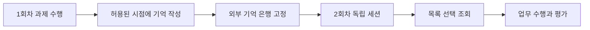

# 보고서 네 장 구성

2026-11-14 · 보고서·발표 작성자에게 전달할 구성

연구 설명은 메모리의 필요성, 기존 연구의 초점, 우리 실험의 큰 그림, 측정과 기여 목표의 네 장으로 구성한다. 다음 내용은 실험 계획이며 달성 성능이나 확정된 신규성으로 서술하지 않는다.

## 첫 장 메모리가 중요한 이유

경험은 계속 늘어나지만 각 판단에서 처리할 문맥과 비용에는 한계가 있다. 따라서 무엇을 기억으로 남기고 언제 어떤 정보를 불러올지가 중요하다. 여러 저장·조회 방법이 제안돼 있으며, 어떤 조합이 어떤 과제에서 이득과 손해를 만드는지 비교할 필요가 있다.

메모리가 항상 도움이 된다거나 저장·조회 방법이 전혀 알려지지 않았다고 단정하지 않는다. 저장 품질·선택·실제 활용을 구분하는 연구 질문으로 연결한다. 문맥 한도는 동기이며 임의의 저장/대화 토큰 배분을 실험 기본값으로 넣는 근거는 아니다.

## 두 번째 장 관련 연구의 초점

| 초점 | 소개할 예 |
| --- | --- |
| 과거 정보 회상·검색·읽기 | LongMemEval |
| 성공·실패 경험에서 전략 추출과 후속 실행 | ReasoningBank |
| 기억 추출·갱신의 누락·오류 | HaluMem |
| 구성요소 교체와 공통 평가 지원 | MemTools |
| 수행 중·과제 간 기억 변화 | EvoMemBench |
| 기억 도구와 세션 간 snapshot·후속 질문 | BFCL V4 Memory |

각 연구가 무엇을 비교하고 어떤 수치를 쓰는지 보여준다. 일부 초점만으로 각 연구의 전체 범위를 한정하지 않는다. 근거와 가까운 비교 대상은 [관련 연구](../research/related-work.md)를 사용한다.

## 세 번째 장 경험에서 후속 수행까지

두 세션은 외부 기억을 통해 과거 경험을 공유한다. 업무 상태·대화·사용자·provider의 세션 연결은 초기화한다. 각 평가 과제는 같은 시작 은행을 복제하며 그 변경을 다른 평가로 돌려보내지 않는다.

수행 중·종료 후·병행을 저장 시점의 비교 축으로 둔다. 표현 형태와 조회 시점·선택·재가공도 별도 축이다. 다음 두 질문을 나눠 설명한다.

- 자기 과제의 경험 기억이 다음 시도에서 유효하게 쓰이는가.
- 여러 과제의 N개 기억 중 현재 조건에 필요한 내용을 선택하고 활용하는가.

올바른 선택을 원천 과제 ID 일치로 판정하지 않는다. 은행에 필요 근거가 있었는지, 입력에 들어왔는지, 이후 행동과 결과가 달라졌는지 구분한다. 2회차의 무기억 기준선과 독립 반복으로 재실행 변동도 확인한다.

초기 환경은 τ²-bench이며, 공통 기억·기록·분석과 환경별 실행·채점을 분리해 AppWorld·BFCL로 확장하는 구조를 목표로 한다. 지원 목표와 실제 검증 범위를 구분한다.

## 네 번째 장 측정과 기여 목표

| 확인할 내용 | 표현할 수치 |
| --- | --- |
| 수행 효과 | 성공 확률 차이·불확실성, 실패→성공·성공→실패와 양쪽 성공/실패 |
| 실패 상태의 변화 | 요구사항 충족·부분 진척·달성 후 후퇴 |
| 기억 품질과 선택 | 근거 보존·정확성·실제 입력 도달·시점 적합성 |
| 누적과 전이 | 이전 과제 유지·새 과제 전이·체크포인트·순서 변동 |
| 효율 | 작성·조회·가공·수행의 호출·토큰·시간·비용 |

기여 목표는 재현 가능한 평가 프레임워크·자료, 타당한 측정과 진단, 정책 조합의 새로운 실증적 발견이다. 기억의 변경·선택·노출을 후속 회복·회귀·진척에 연결하고 통제 비교와 개입으로 설명을 검증한다.

세션 분리·N개 중 선택·도구 제공·여러 벤치 지원 자체를 신규성의 증명으로 쓰지 않는다. 실제 정의·분모·필요 주석·해석 범위는 [측정과 분석](../research/metrics.md)을 따른다.

전체 연구 목표는 [연구 계획](../research/plan.md), 과제·은행·통제는 [실험 프로토콜](../research/experiment-protocol.md), 구현 세부는 [상세 설계](../design/architecture.md)를 바탕으로 작성한다.
